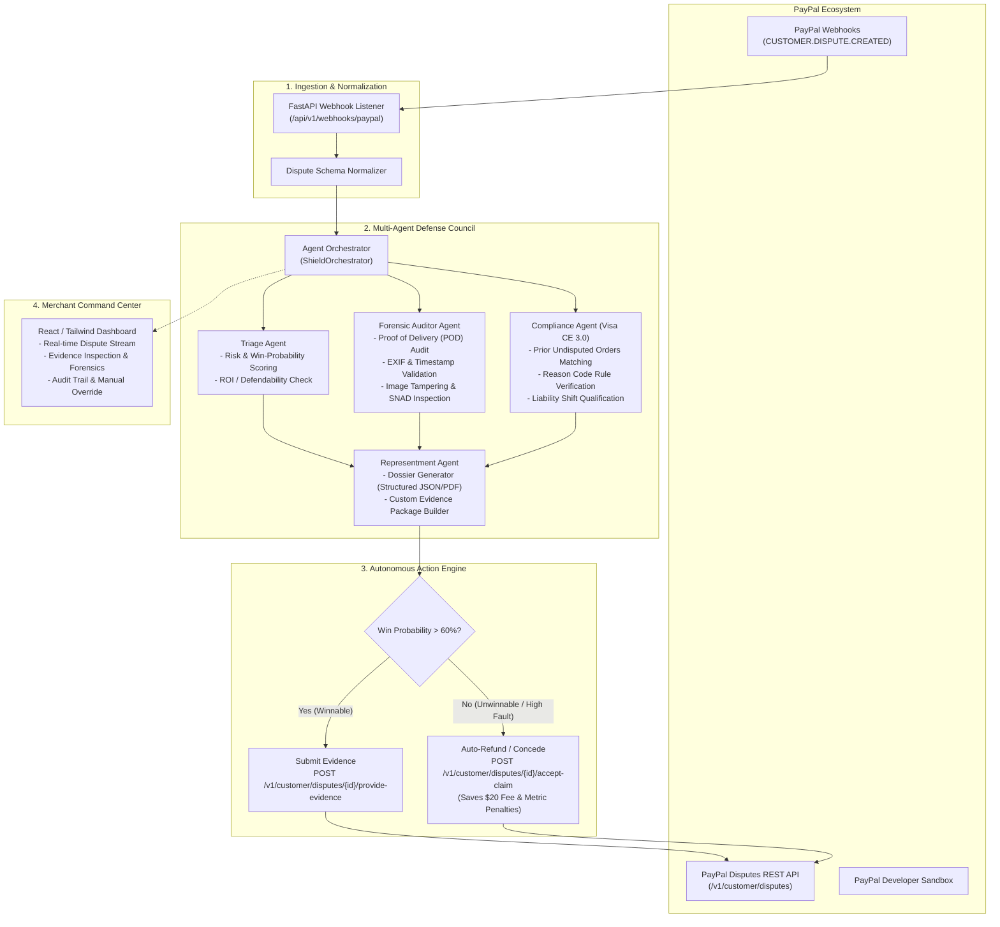

# ShieldAgent: System Architecture & Workflow

**ShieldAgent** is an Autonomous Dispute Defense & Representment Engine engineered for PayPal merchants. It intercepts inbound customer disputes, executes forensic multi-agent evidence audits, leverages card network compliance rules (Visa Compelling Evidence 3.0), and autonomously submits dispute representment packages directly through the PayPal Disputes API.

---

## 1. High-Level Architecture Overview

---

## 2. The Four Specialized Agents

### Agent 1: Triage & Financial ROI Agent
* **Purpose**: Determines whether a dispute is economically and procedurally worth defending.
* **Logic**:
  - Evaluates dispute amount vs. non-refundable card network dispute fee (\$15–\$25).
  - Checks merchant SLA deadline (usually 7–10 days).
  - Calculates initial **Win Probability Score (0–100%)**.
  - Recommends: `DEFEND` or `AUTO_CONCEDE` (saving the merchant fee and protecting their dispute ratio).

### Agent 2: Forensic Auditor Agent
* **Purpose**: Validates physical delivery and inspects buyer claims for fraud.
* **Capabilities**:
  - **Carrier Tracking Triangulation**: Ingests carrier data (FedEx, UPS, USPS) and checks if the carrier's GPS delivery point matches the buyer's PayPal verified address.
  - **EXIF & Timestamp Forensics**: Inspects metadata on delivery photos and buyer-submitted damage photos (verifies camera timestamp vs. delivery time).
  - **Visual Claim Inspection**: Uses multimodal vision to compare catalog product images against customer-uploaded "damaged" photos to identify false SNAD claims.

### Agent 3: Network Compliance Agent (Visa CE 3.0 & Mastercard Rules)
* **Purpose**: Exploits card network rules to trigger automatic liability shift back to the issuing bank.
* **Visa Compelling Evidence 3.0 (CE 3.0) Engine**:
  - Scans merchant order history for previous transactions by the same cardholder.
  - If **at least 2 undisputed transactions** exist between 120 and 365 days old that share either:
    1. Matching IP address
    2. Matching device fingerprint
    3. Matching physical shipping address
  - **Outcome**: Liability shifts to the card issuer immediately, guaranteeing an automatic merchant win under Visa rules!

### Agent 4: Representment Dossier Generator
* **Purpose**: Packages all evidence, logs, and compliance certificates into an airtight dispute response.
* **Capabilities**:
  - Formats data to match exact PayPal Disputes API requirements (`PROOF_OF_DELIVERY`, `ADDITIONAL_INFORMATION_AFFIDAVIT`, etc.).
  - Generates clear narrative summaries for human underwriters if secondary review is triggered.

---

## 3. PayPal Disputes API Integration Mapping

| Action | PayPal API Endpoint | Purpose in ShieldAgent |
| :--- | :--- | :--- |
| **Listen** | Webhook: `CUSTOMER.DISPUTE.CREATED` | Instantly wakes up the agent when a dispute is filed |
| **Fetch** | `GET /v1/customer/disputes/{dispute_id}` | Retrieves buyer reason code, amount, and uploaded evidence |
| **Provide Evidence** | `POST /v1/customer/disputes/{dispute_id}/provide-evidence` | Autonomously submits our synthesized defense dossier |
| **Accept Claim** | `POST /v1/customer/disputes/{dispute_id}/accept-claim` | Autonomously settles unwinnable claims to avoid dispute fees |
| **Send Message** | `POST /v1/customer/disputes/{dispute_id}/send-message` | Engages the buyer via PayPal's native resolution channel |
