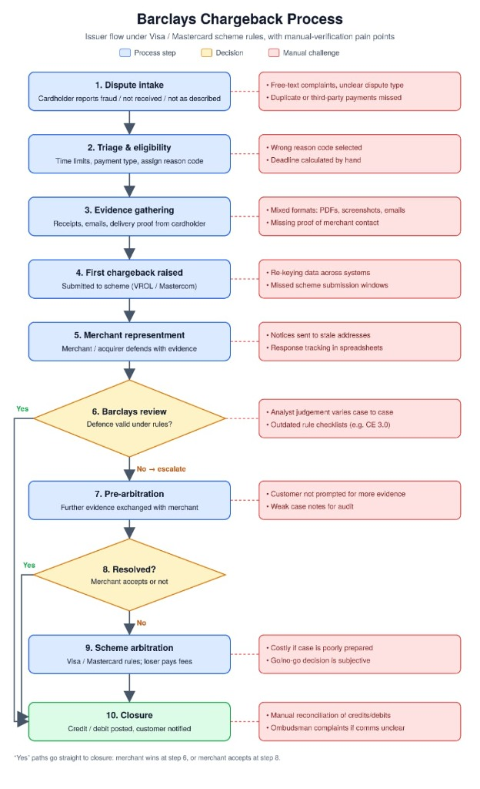

# Card Scheme Dispute Lifecycle, Reason Codes & Scheme Rules

This document outlines the end-to-end chargeback lifecycle under **Visa and Mastercard Scheme Rules** (as processed by issuers like Barclays, Chase, and acquirers/payment facilitators like **PayPal**).

---

## 1. The 10-Stage Scheme Dispute Lifecycle

The dispute process runs strictly on card network rules (Visa VROL and Mastercard Mastercom). Issuers cannot alter these rules.

| Stage | Scheme Action | Manual Bottlenecks & Failure Modes | ShieldAgent Automated Countermeasure |
| :--- | :--- | :--- | :--- |
| **1. Dispute Intake** | Cardholder reports fraud, INR, or SNAD | Unclear dispute classification; missed duplicate charges | Schema normalization & PayPal reason code parsing |
| **2. Triage & Eligibility** | Reason code assigned; time limits evaluated | Manual deadline calculation; wrong reason codes picked | Staggered Scheme SLA Engine (Day N-1 boundary alerts) |
| **3. Evidence Gathering** | Cardholder / merchant submits receipts, courier proofs | Mixed unstructured formats (PDFs, screenshots, emails); missing proof of merchant contact | Automated OCR, carrier POD tracking, and contact log verification |
| **4. First Chargeback** | Submitted to scheme (VROL / Mastercom) | Re-keying data between core banking & portals; missed filing windows | PayPal webhook listener (`CUSTOMER.DISPUTE.CREATED`) |
| **5. Merchant Representment** | Merchant / acquirer defends with evidence dossier | Notices sent to stale addresses; manual spreadsheet tracking | Autonomous dossier generator (`representment_agent.py`) |
| **6. Issuer / Review** | Reviewer tests if defense complies with scheme rules | Analyst judgment variance; outdated rule checklists (e.g., missing CE 3.0) | Automated **Visa CE 3.0** liability shift certification |
| **7. Pre-Arbitration** | Further evidence exchanged; escalated dispute | Incomplete customer prompts; weak case audit logs | Structured immutable case audit trail |
| **8. Resolution Point** | Merchant accepts liability or contests | Subjective human decision | Expected Value (EV) calculator for optimal decision |
| **9. Scheme Arbitration** | Official Visa/Mastercard ruling; **loser pays $500+ fee** | Costly when poorly prepared; high penalty risk | **Arbitration Risk Engine:** Evaluates EV vs $500 fee before filing |
| **10. Closure** | Financial credit/debit posted; case resolved | Manual reconciliation; Ombudsman complaints | Automated webhook execution via PayPal Disputes API |

---

## 2. Mastercard Scheme Rule: Mandatory Prior Merchant Contact

Under **Mastercard Rules (Reason Codes 4853 & 4837)**:
* Cardholders filing commercial disputes (e.g., Not as Described, Defective Merchandise, Billing Errors) **must first attempt resolution with the merchant directly**.
* If an issuer files a chargeback without proof of prior contact, the case suffers from a **procedural scheme defect**.
* **ShieldAgent's Compliance Engine** inspects the customer support and order timeline. If no prior contact occurred, ShieldAgent generates an immediate procedural refutation, forcing liability shift back to the issuer.

---

## 3. Scheme Arbitration Risk ($500 Fee Protection)

In Stage 9 (Scheme Arbitration), formal card network filing costs \$500+ in non-refundable arbitration fees for the losing party.
* Defending a \$60 dispute at arbitration with a 60% win probability has a **negative expected value** ($-\$188$).
* ShieldAgent's **Arbitration Go/No-Go Decision Engine** calculates:
  $$\text{EV} = (P_{\text{win}} \times \text{Amount}) - ((1 - P_{\text{win}}) \times (\text{Amount} + \$500))$$
* If $\text{EV} < 0$, ShieldAgent autonomously advises `CONCEDE_ARBITRATION`, saving the merchant the \$500 fee and protecting their card scheme standing.
